

  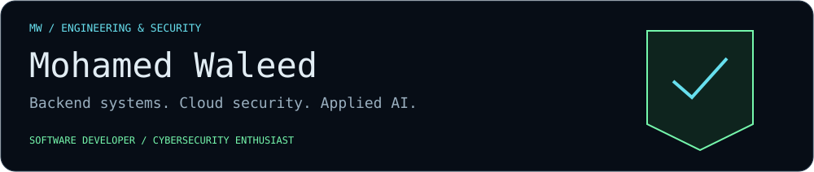

  <a href="#about">About</a> · <a href="#technical-stack">Stack</a> · <a href="#selected-projects">Projects</a> · <a href="#github-activity">Activity</a>

  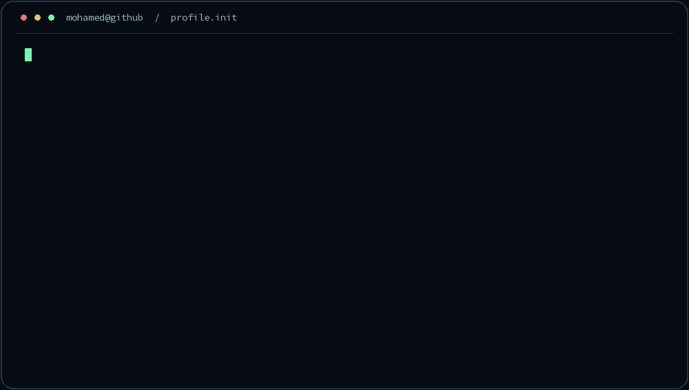

View the terminal without animation

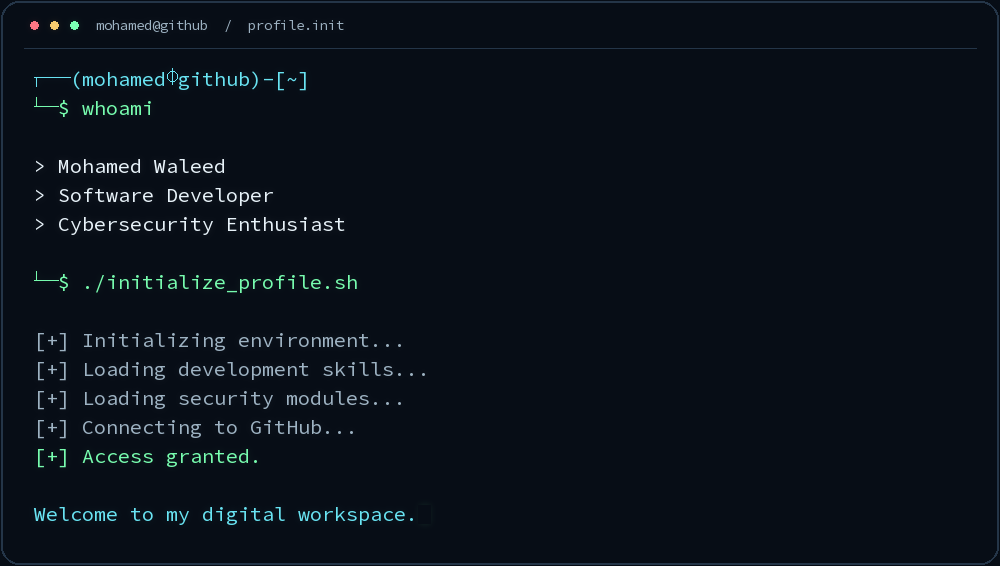

## About

I'm **Mohamed Waleed**, a software developer with a focus on backend development, cloud security, and AI systems. My interests connect secure applications, practical automation, and AI/LLM integration.

**Training:** DEPI AWS Cloud Security Scholarship — MCIT / NTI.

  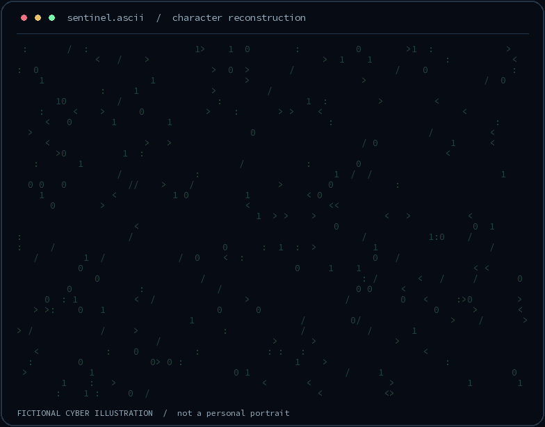

View the ASCII illustration without animation

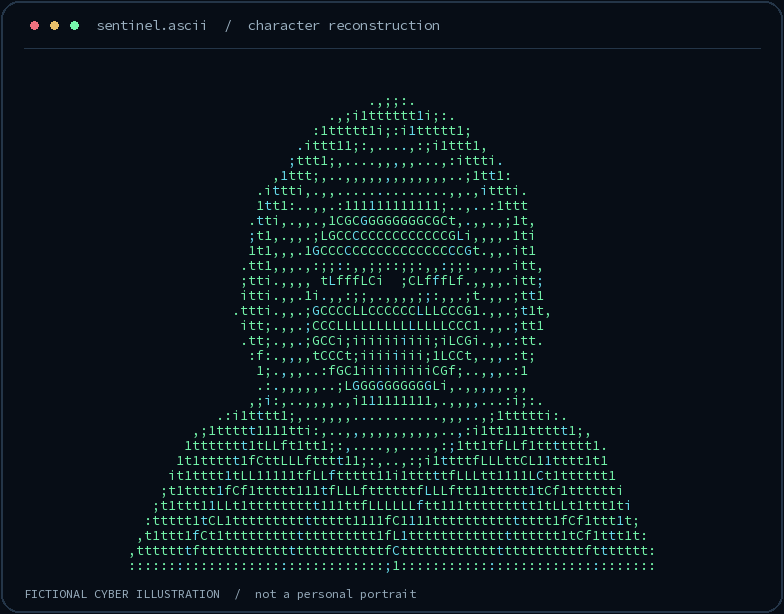

## Technical stack

  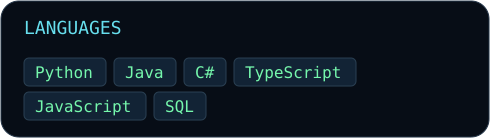
  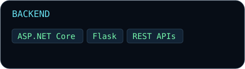
  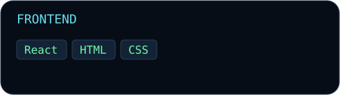
  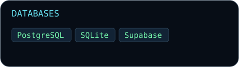
  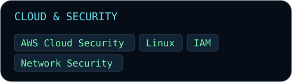
  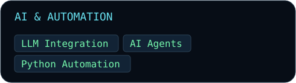

**Developer tools:** Git · GitHub · Linux.

## Selected projects

### 01 / BMO — AI Social Companion Robot

An AI-powered social companion robot designed to support autistic children.

**My role:** Main Developer and Technical Lead.

`Python` `asyncio` `Raspberry Pi 5` `Silero VAD` `Faster-Whisper` `Piper TTS` `LLMs` `SQLite` `ChromaDB`

[Explore BMO on GitHub →](https://github.com/Mishostrange/BMO11)

### 02 / Enterprise Training Management Platform

A secure training management system for organizations, administrators, and trainees. Features include secure access links, role-based authorization, audit logging, attendance tracking, and Excel imports.

`React` `TypeScript` `ASP.NET Core` `EF Core` `PostgreSQL`

### 03 / Business Process Automation

A Python- and Java-based automation system for managing automated X/Twitter workflows.

`Python` `Java` `Automation`

### 04 / AI Football Performance Analysis Platform

**Project concept.** Exploring AI analysis of football matches, player performance, tactical patterns, and team performance.

`AI` `Match Analysis` `Tactical Patterns`

<!-- Project descriptions supplied by the profile owner. Add only verified public repository URLs. -->

## GitHub activity

  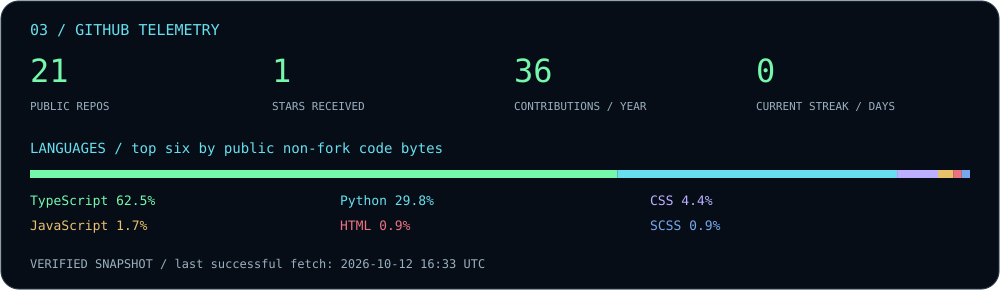
  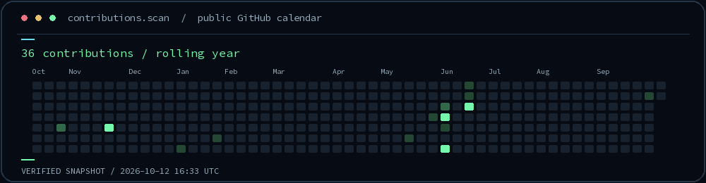

Statistics refresh daily from GitHub. Contributions cover GitHub's rolling-year calendar. Language shares are normalized across the top six languages by code bytes in public, owned, non-fork repositories; stars are received across public owned repositories. Streaks use calendar dates in UTC and include yesterday when today has no activity.

View the contribution calendar without animation

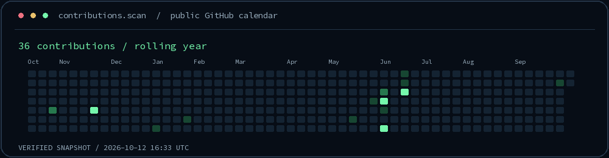

### Recent public activity

<!-- ACTIVITY:START -->

No recent public events were returned by GitHub.

*Snapshot: 2026-10-12 16:33 UTC. Public events only; GitHub may delay or omit events.*

<!-- ACTIVITY:END -->

---

  <a href="https://github.com/Mishostrange">github.com/Mishostrange</a> 
  Build thoughtfully. Automate deliberately. Keep learning.

